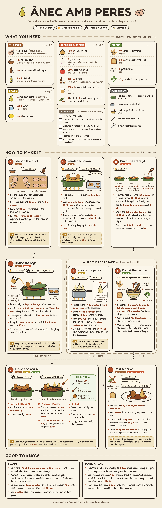

# Visual recipes

Illustrated flowchart versions of recipes. Each step card pairs a drawing with the
step's real detail: quantities, heat level, timings and the visual or doneness cue.

## Ànec amb Peres (Catalan duck with pears)



| File | What it is |
| --- | --- |
| `anec-amb-peres/anec-amb-peres-flowchart.png` | Rendered poster (2400 px wide) |
| `anec-amb-peres/flowchart.html` | Source: HTML/CSS layout with inline SVG illustrations |

Layout:

- **What you need**: ingredients grouped by component (duck, sofregit & braise,
  pears, picada), each tagged with the steps that use it, plus equipment and a prep list.
- **How to make it**: eight step cards linked by arrows. Steps 5 and 6 run in
  parallel while the legs braise (step 4), then all three merge into step 7.
- **Good to know**: swaps and make-ahead notes from the chef's tips.

Source recipe: “Ànec amb Peres” by Chef Isabel, Culinary Explorer.

## Re-rendering the PNG

Edit `flowchart.html`, then run:

```sh
node tools/render.js anec-amb-peres/flowchart.html anec-amb-peres/anec-amb-peres-flowchart.png
```

This needs Node and Playwright with Chromium. An optional third argument sets the
pixel scale (default `2`).

## Fonts

Fredoka and Patrick Hand, bundled in `assets/fonts/` under the SIL Open Font License 1.1.
